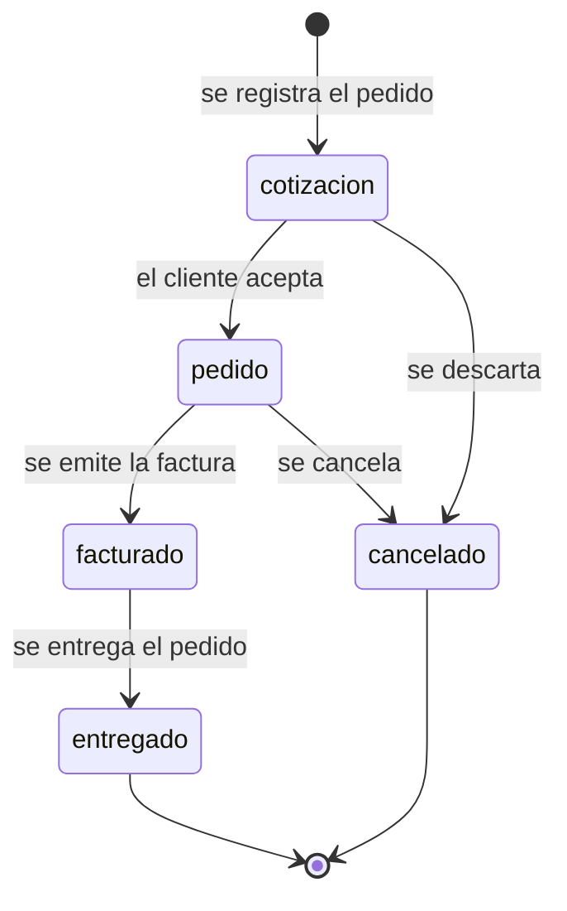

# Modelo de Datos: Módulo de Ventas

**Módulo**: Ventas (`002-modulo-ventas`)  
**Base reutilizable**: Módulo Base ERP (`001-erp-base-module`)  
**Implementación de referencia**: `modulo-ventas/src/module-config.js` (configuración) y `modulo-ventas/src/storage.js` (persistencia)

## 1. Alcance y convenciones

El Módulo de Ventas especializa el modelo genérico del módulo base sin modificar su código central: la configuración (`userConfig`) reetiqueta **Entidad → Cliente** y **Documento → Pedido de Venta**, y agrega los campos propios del dominio comercial.

Reglas del modelo:

- Cada **Pedido de Venta** pertenece a **exactamente un Cliente**; un Cliente puede tener **cero o N** pedidos.
- Un Pedido **nunca** queda sin Cliente (la FK es obligatoria y se valida al escribir).
- Al eliminar un Cliente se eliminan **en cascada** sus Pedidos.
- Todo el modelo vive en el `localStorage` del navegador; no hay backend ni base de datos relacional.

Convenciones de notación: `PK` clave primaria · `FK` clave foránea · `UK` clave única · `NN` no nulo · `*` campo obligatorio en el formulario.

---

## 2. Diagrama entidad-relación

```mermaid
erDiagram
    CLIENTE ||--o{ PEDIDO_VENTA : "genera"

    CLIENTE {
        string id PK "Identificador interno del registro"
        string entity_id UK "Clave de negocio referenciada por PEDIDO_VENTA"
        string name NN "Nombre o razon social"
        string code NN "Codigo de negocio (RUT, RFC, NIT)"
        string taxId "Identificacion fiscal"
        string email "Correo de contacto"
        string phone "Telefono de contacto"
        string address "Direccion del cliente"
        string category "Tipo o segmento de cliente"
        string description "Notas internas"
        string targetDate "Fecha objetivo (YYYY-MM-DD)"
        number creditLimit "Limite de credito"
        string paymentTerms "Condiciones de pago"
        string vendedor "Vendedor asignado (campo propio)"
        string zona "Zona (campo propio)"
        string createdAt "Marca de tiempo ISO 8601"
        string updatedAt "Marca de tiempo ISO 8601"
    }

    PEDIDO_VENTA {
        string id PK "Identificador interno del documento"
        string entity_id FK "Referencia a CLIENTE.entity_id"
        string series "Serie del documento (PED, FAC)"
        number folio NN "Folio consecutivo"
        string startDate NN "Fecha de emision del pedido"
        string endDate NN "Fecha de fin / entrega comprometida"
        number quantity "Cantidad de unidades"
        number subtotal "Importe antes de descuentos e impuestos"
        number discount "Descuento aplicado"
        number taxAmount "Impuesto del pedido"
        number totalAmount "Importe total"
        string currency "Moneda (CLP, MXN, USD)"
        string paymentTerms "Condiciones de pago"
        string notes "Notas u observaciones"
        string status "Estado del ciclo de vida comercial"
        string canal "Canal de venta (campo propio)"
        string fechaEntrega "Fecha de entrega (campo propio)"
        string createdAt "Marca de tiempo ISO 8601"
        string updatedAt "Marca de tiempo ISO 8601"
    }
```

---

## 3. Entidad: CLIENTE (datos maestros del comprador)

Raíz del agregado comercial: agrupa los datos Maestros del comprador contra los que se registran los pedidos.

| Atributo | Clave | Tipo | Nulo | Regla de validación | Campo físico | Etiqueta en UI |
|---|---|---|---|---|---|---|
| Identificador | PK | string | NN | Generado automáticamente; nunca se edita | `id` | (oculto) |
| Clave de negocio | UK, FK | string | NN | Generada automáticamente, única; es la referencia usada por los pedidos | `entity_id` | (oculto) |
| Nombre / Razón social | | string | NN | Obligatorio, no vacío | `name` | Nombre * |
| Código de cliente | | string | NN | Obligatorio, no vacío (RUT, RFC, NIT, CUIT) | `code` | Código * |
| Identificación fiscal | | string | Nulo | Texto recortado cuando se proporciona | `taxId` | Identificación fiscal |
| Correo electrónico | | string | Nulo | Debe tener formato de correo válido | `email` | Correo electrónico |
| Teléfono | | string | Nulo | Texto libre | `phone` | Teléfono |
| Dirección | | string | Nulo | Texto libre | `address` | Dirección |
| Categoría | | string | Nulo | Tipo o segmento de cliente | `category` | Categoría |
| Descripción | | string | Nulo | Notas internas | `description` | Descripción |
| Fecha objetivo | | string (fecha) | Nulo | Fecha de calendario válida en `YYYY-MM-DD` | `targetDate` | Fecha objetivo |
| Límite de crédito | | number | Nulo | Número no negativo | `creditLimit` | Límite de crédito |
| Condiciones de pago | | string | Nulo | Texto libre (p. ej., contado, neto 30) | `paymentTerms` | Condiciones de pago |
| Vendedor asignado | | string | Nulo | Texto libre; referencia al comercial responsable | `vendedor` | Vendedor asignado |
| Zona | | string (select) | Nulo | `Norte`, `Sur`, `Este`, `Oeste`, `Centro` | `zona` | Zona |
| Creado en | | string (ISO 8601) | NN | Marca de tiempo de creación | `createdAt` | — |
| Actualizado en | | string (ISO 8601) | NN | Se refresca en cada edición | `updatedAt` | — |

**Campos propios de Ventas**: `vendedor` y `zona` se declaran como campos personalizados del objetivo `entity` en la configuración; no viven en el núcleo del módulo base.

**Participación en búsquedas**: el buscador compara el término contra `name`, `code`, `taxId`, `email`, `phone`, `address`, `category`, `description`, `targetDate`, `paymentTerms` y los campos propios (`vendedor`, `zona`).

---

## 4. Entidad: PEDIDO DE VENTA (transacción comercial)

Entidad dependiente: representa la operación comercial registrada para un cliente, con su número de documento, su desglose económico y su estado dentro del ciclo comercial.

| Atributo | Clave | Tipo | Nulo | Regla de validación | Campo físico | Etiqueta en UI |
|---|---|---|---|---|---|---|
| Identificador | PK | string | NN | Generado automáticamente | `id` | (oculto) |
| Cliente asociado | FK | string | NN | Debe coincidir con el `entity_id` de un Cliente existente | `entity_id` | Cliente * |
| Serie | | string | Nulo | Agrupa folios consecutivos (p. ej., `PED`) | `series` | Serie |
| Folio | | number | NN | Entero positivo; junto con la serie forma el número del pedido | `folio` | Folio * |
| Fecha de emisión | | string (fecha) | NN | Fecha de calendario válida en `YYYY-MM-DD` | `startDate` | Fecha de inicio * |
| Fecha de fin / entrega | | string (fecha) | NN | Válida e igual o posterior a `startDate` | `endDate` | Fecha de fin * |
| Cantidad | | number | Nulo | Entero positivo | `quantity` | Cantidad |
| Subtotal | | number | Nulo | Número no negativo | `subtotal` | Subtotal |
| Descuento | | number | Nulo | Número no negativo y **no puede superar el subtotal** | `discount` | Descuento |
| Impuesto | | number | Nulo | Número no negativo | `taxAmount` | Impuesto |
| Importe total | | number | Nulo | Número no negativo | `totalAmount` | Importe total |
| Moneda | | string | Nulo | Código de moneda (`CLP`, `MXN`, `USD`) | `currency` | Moneda |
| Condiciones de pago | | string | Nulo | Texto libre | `paymentTerms` | Condiciones de pago |
| Notas | | string | Nulo | Texto libre | `notes` | Notas |
| Estado | | string (enum) | Nulo | Debe pertenecer al ciclo de vida configurado | `status` | Estado |
| Canal de venta | | string (select) | Nulo | `Tienda`, `Web`, `Teléfono`, `Distribuidor` | `canal` | Canal de venta |
| Fecha de entrega | | string (fecha) | Nulo | Fecha de calendario válida en `YYYY-MM-DD` | `fechaEntrega` | Fecha de entrega |
| Creado en | | string (ISO 8601) | NN | Marca de tiempo de creación | `createdAt` | — |
| Actualizado en | | string (ISO 8601) | NN | Se refresca en cada edición | `updatedAt` | — |

**Campos propios de Ventas**: `canal` y `fechaEntrega` se declaran como campos personalizados del objetivo `document` en la configuración.

**Nota de cálculo**: el módulo no recalcula `totalAmount`; el importe total, el impuesto y el descuento son valores ingresados por el usuario, validados de forma independiente.

### 4.1 Ciclo de vida del pedido



| Estado actual | Transiciones permitidas | Estado final |
|---|---|---|
| `cotización` | `pedido`, `cancelado` | No |
| `pedido` | `facturado`, `cancelado` | No |
| `facturado` | `entregado` | No |
| `entregado` | — | Sí |
| `cancelado` | — | Sí |

Reglas asociadas:

- Al crear un pedido se ofrecen todos los estados configurados; al editarlo solo el estado actual y sus transiciones válidas.
- Una transición no permitida se rechaza con el mensaje `Transición de estado inválida de "<origen>" a "<destino>"`.
- Si se retira el ciclo de vida de la configuración, `status` vuelve a ser texto libre.

---

## 5. Relaciones

### 5.1 CLIENTE 1 : N PEDIDO DE VENTA

| Aspecto | Definición |
|---|---|
| Dirección | `PEDIDO_VENTA.entity_id` → `CLIENTE.entity_id` |
| Cardinalidad cliente → pedido | `1 .. N` (un cliente puede no tener pedidos) |
| Cardinalidad pedido → cliente | `1 .. 1` (obligatoria, un pedido siempre tiene un cliente) |
| Integridad referencial | Se valida al crear y al editar un pedido: el `entity_id` debe existir en la colección de clientes |
| Borrado en cascada | Al eliminar un cliente se eliminan todos sus pedidos (`deleteDocumentsForEntity`) |
| Borrado de pedido | Nunca afecta al cliente; solo se retira el pedido |

### 5.2 Reglas de negocio derivadas de la relación

1. No existen pedidos huérfanos: un pedido sin cliente válido no se persiste.
2. Al eliminar un cliente, sus pedidos desaparecen de la lista, de la gestión y de la búsqueda (cascada).
3. Un cliente puede tener pedidos en cualquier estado; la cascada no distingue por estado.
4. El panel expone dos estadísticas derivadas de las colecciones: total de clientes y total de pedidos, recalculadas en cada visita.

---

## 6. Restricciones de integridad

| # | Restricción | Ámbito | Comportamiento ante el incumplimiento |
|---|---|---|---|
| R-01 | `CLIENTE.name` no vacío | Cliente | Se bloquea el guardado con `El nombre es obligatorio` |
| R-02 | `CLIENTE.code` no vacío | Cliente | Se bloquea el guardado con `El código es obligatorio` |
| R-03 | `CLIENTE.email` con formato válido si se informa | Cliente | Se bloquea el guardado con `El correo electrónico no es válido` |
| R-04 | `CLIENTE.targetDate` es fecha válida si se informa | Cliente | Se bloquea el guardado con `La fecha objetivo debe ser una fecha válida (YYYY-MM-DD)` |
| R-05 | `CLIENTE.creditLimit` es número no negativo si se informa | Cliente | Se bloquea el guardado con `El límite de crédito debe ser un número no negativo` |
| R-06 | `CLIENTE.zona` pertenece a las opciones declaradas | Cliente | Se bloquea el guardado indicando las opciones válidas |
| R-07 | `PEDIDO_VENTA.entity_id` referencia un cliente existente | Pedido | Se bloquea el guardado con `Selecciona una entidad para el documento` |
| R-08 | `PEDIDO_VENTA.folio` es entero positivo | Pedido | Se bloquea el guardado con `El folio debe ser un entero positivo` |
| R-09 | `PEDIDO_VENTA.startDate` y `endDate` son fechas válidas | Pedido | Se bloquea el guardado indicando el formato esperado |
| R-10 | `PEDIDO_VENTA.endDate` ≥ `startDate` | Pedido | Se bloquea el guardado con `La fecha de fin debe ser igual o posterior a la fecha de inicio` |
| R-11 | `PEDIDO_VENTA.quantity` es entero positivo si se informa | Pedido | Se bloquea el guardado con `La cantidad debe ser un entero positivo` |
| R-12 | Montos (`subtotal`, `discount`, `taxAmount`, `totalAmount`) no negativos | Pedido | Se bloquea el guardado indicando que no puede ser negativo |
| R-13 | `discount` ≤ `subtotal` | Pedido | Se bloquea el guardado con `El descuento no puede superar el subtotal` |
| R-14 | `status` pertenece a los estados configurados | Pedido | Se bloquea el guardado indicando los estados válidos |
| R-15 | La transición de `status` está permitida por el ciclo de vida | Pedido | Se bloquea el guardado con `Transición de estado inválida de "<origen>" a "<destino>"` |
| R-16 | `canal` pertenece a las opciones declaradas | Pedido | Se bloquea el guardado indicando las opciones válidas |
| R-17 | `fechaEntrega` es fecha válida si se informa | Pedido | Se bloquea el guardado indicando el formato esperado |
| R-18 | Claves de campos propios no colisionan con campos base ni se repiten | Configuración | La configuración se rechaza con el error de validación y se usan los valores predeterminados |

---

## 7. Configuración del módulo (perfil de Ventas)

El modelo de negocio se inyecta en el módulo base mediante un único archivo de configuración, sin cambios en el código central.

```json
{
  "moduleName": "Ventas",
  "labels": {
    "entity": "Cliente",
    "entities": "Clientes",
    "document": "Pedido de Venta",
    "documents": "Pedidos de Venta"
  },
  "customFields": [
    { "target": "entity", "key": "vendedor", "label": "Vendedor asignado", "type": "text", "required": false },
    { "target": "entity", "key": "zona", "label": "Zona", "type": "select", "required": false, "options": ["Norte", "Sur", "Este", "Oeste", "Centro"] },
    { "target": "document", "key": "canal", "label": "Canal de venta", "type": "select", "required": false, "options": ["Tienda", "Web", "Teléfono", "Distribuidor"] },
    { "target": "document", "key": "fechaEntrega", "label": "Fecha de entrega", "type": "date", "required": false }
  ],
  "statusLifecycle": {
    "statuses": ["cotización", "pedido", "facturado", "entregado", "cancelado"],
    "transitions": {
      "cotización": ["pedido", "cancelado"],
      "pedido": ["facturado", "cancelado"],
      "facturado": ["entregado"],
      "entregado": [],
      "cancelado": []
    }
  },
  "theme": { "accentColor": "#0f62fe" }
}
```

Tipos admitidos para campos personalizados: `text`, `number`, `date`, `select`.

---

## 8. Persistencia física

### 8.1 Colecciones almacenadas

| Colección | Clave en `localStorage` | Contenido |
|---|---|---|
| Clientes | `erp_base_module:entities` | Lista (array JSON) de objetos `CLIENTE` |
| Pedidos | `erp_base_module:documents` | Lista (array JSON) de objetos `PEDIDO_VENTA` |

Las claves son las del módulo base: la especificación de Ventas reutiliza el mismo almacén, por lo que un cliente y un pedido conviven en el mismo espacio de trabajo.

### 8.2 Documento almacenado de un cliente

```json
{
  "id": "m9x1a2b-c3d4e5",
  "entity_id": "m9x1a2b-f7g8h9",
  "name": "Distribuidora Andes Ltda.",
  "code": "76.543.210-9",
  "taxId": "76.543.210-9",
  "email": "compras@andes.cl",
  "phone": "+56 9 1234 5678",
  "address": "Av. Siempre Viva 742",
  "category": "Distribuidor",
  "creditLimit": 5000000,
  "paymentTerms": "neto 30",
  "vendedor": "C. Rojas",
  "zona": "Centro",
  "createdAt": "2026-10-20T14:03:11.482Z",
  "updatedAt": "2026-10-20T14:03:11.482Z"
}
```

### 8.3 Documento almacenado de un pedido

```json
{
  "id": "p0q1r2s-t3u4v5",
  "entity_id": "m9x1a2b-f7g8h9",
  "series": "PED",
  "folio": 1042,
  "startDate": "2026-10-20",
  "endDate": "2026-10-27",
  "quantity": 120,
  "subtotal": 1200000,
  "discount": 50000,
  "taxAmount": 225900,
  "totalAmount": 1375900,
  "currency": "CLP",
  "paymentTerms": "neto 30",
  "notes": "Entrega en bodega central",
  "status": "pedido",
  "canal": "Tienda",
  "fechaEntrega": "2026-10-27",
  "createdAt": "2026-10-20T14:05:02.117Z",
  "updatedAt": "2026-10-20T14:05:02.117Z"
}
```

### 8.4 Operaciones sobre las colecciones

| Operación | Efecto |
|---|---|
| `loadEntities()` / `saveEntities(lista)` | Lectura y escritura de la colección de clientes |
| `loadDocuments()` / `saveDocuments(lista)` | Lectura y escritura de la colección de pedidos |
| `addEntity(payload)` | Valida, genera `id` y `entity_id`, agrega el cliente y fija marcas de tiempo |
| `updateEntity(id, updates)` | Valida, fusiona, refresca `updatedAt` y preserva el resto de atributos |
| `deleteEntity(id)` | Elimina el cliente y, en cascada, sus pedidos |
| `addDocument(payload)` | Valida (FK, folios, fechas, montos, estado), agrega el pedido y fija marcas de tiempo |
| `updateDocument(id, updates)` | Valida contra el estado previo para aplicar las transiciones, refresca `updatedAt` |
| `deleteDocument(id)` | Elimina únicamente el pedido |
| `deleteDocumentsForEntity(entity_id)` | Elimina todos los pedidos de un cliente (usado por la cascada) |
| `searchEntities(termino)` | Filtra clientes por los campos base y los campos propios |

---

## 9. Extensiones previstas (fuera del alcance actual)

El modelo actual cubre el núcleo del flujo comercial (maestro de clientes y registro de pedidos). Las siguientes entidades corresponden a los pasos siguientes del propósito del proyecto y **no están implementadas** en el Módulo de Ventas actual.

| Entidad propuesta | Propósito | Cómo se materializaría | Impacto |
|---|---|---|---|
| `PRODUCTO` (catálogo / lista de precios) | Consultar precios y existencias antes de cotizar | Requiere una colección propia: el modelo base solo admite dos (entidades y documentos) | Medio |
| `DETALLE_PEDIDO` (líneas) | Desglosar el pedido en producto, cantidad y precio unitario | Requiere estructura anidada o colección auxiliar; hoy la cantidad y los montos son agregados a nivel de pedido | Medio |
| `COTIZACION` | Pre-venta con vigencia y aceptación del cliente | Parcialmente cubierto: un pedido en estado `cotización` representa hoy la pre-venta | Bajo |
| `DEVOLUCION` | Registrar la devolución de un pedido facturado | Modelable como nuevo pedido en estado `cancelado` más un campo propio `pedidoOrigen` que referencie el folio original | Bajo |
| `VENDEDOR` normalizado | Maestro de comerciales con zona y cartera asignada | Hoy `vendedor` es texto libre en el cliente; normalizarlo exige soporte de referencias en campos propios | Medio |

---

## 10. Trazabilidad con la especificación

| Elemento del modelo | Requisito o criterio asociado |
|---|---|
| `CLIENTE` como entidad con `vendedor` y `zona` | Historia de Usuario 1 (002) · FR-003 · SC-001 |
| `PEDIDO_VENTA` con `canal` y `fechaEntrega` | Historia de Usuario 2 (002) · FR-003 · SC-002 |
| Ciclo de vida `cotización → pedido → facturado → entregado` | Historia de Usuario 3 (002) · FR-005 · SC-002 |
| Terminología Cliente / Pedido de Venta | Historia de Usuario 4 (002) · FR-002 |
| FK `PEDIDO_VENTA.entity_id` y borrado en cascada | FR-009 (001) · Historia de Usuario 2, escenario 3 (002) · SC-003 |
| Validación de folios, fechas, montos y descuento | FR-006 y FR-008 (001) · R-08 a R-13 |
| Búsqueda por campos base y propios | FR-028 (001) · FR-004 (002) |
| Persistencia en `localStorage` | Contrato `contracts/entity-storage.md` · FR-001 (002) |
