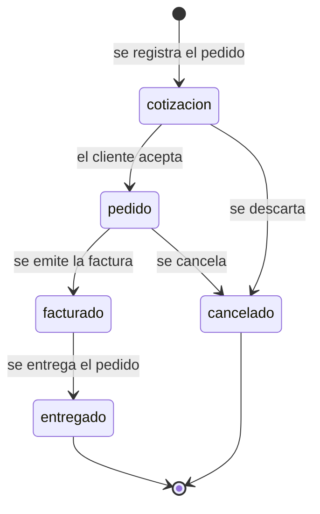

# Modelo de Datos: Módulo de Ventas

**Módulo**: Ventas (`002-modulo-ventas`)  
**Base reutilizable**: Módulo Base ERP (`001-erp-base-module`)  
**Implementación de referencia**: `modulo-ventas/src/module-config.js` (configuración) y `modulo-ventas/src/storage.js` (persistencia)  
**Versión del modelo**: 2.0 — modelo entidad-relación completo  
**Última actualización**: 2026-11-02

## 1. Alcance, niveles del modelo y convenciones

Este documento especifica el **modelo entidad-relación completo** del Módulo de Ventas en dos niveles complementarios:

1. **Modelo lógico completo**: todas las entidades, atributos, claves y relaciones necesarias para cubrir el proceso comercial de punta a punta (maestros, catálogo y precios, cotizaciones, pedidos, facturación, pagos y devoluciones).
2. **Modelo físico implementado**: el subconjunto que hoy persiste el prototipo en `localStorage`, con sus dos colecciones y sus validaciones reales.

La separación permite especificar el dominio completo sin confundirlo con el avance actual del prototipo. Cada entidad declara su estado de implementación:

| Estado | Significado |
|---|---|
| **Implementada** | Existe como colección persistente y sus atributos se validan y almacenan. |
| **Parcial** | El concepto existe como atributo, campo propio o estado, pero no como entidad normalizada. |
| **Planificada** | Forma parte del modelo lógico completo, pero aún no tiene representación física. |

### 1.1 Convenciones de notación

- `PK` clave primaria · `FK` clave foránea · `UK` clave única · `NN` no nulo.
- La obligatoriedad se expresa con `NN`; en las etiquetas de UI los campos obligatorios se marcan con `*`.
- Los tipos lógicos son `string`, `number`, `boolean` y `date` (fecha `YYYY-MM-DD`) o `datetime` (ISO 8601).
- Los importes se expresan en la moneda de la entidad y no admiten valores negativos salvo indicación expresa.
- Los identificadores se generan automáticamente y nunca se editan manualmente.

### 1.2 Estado de implementación por entidad

| Entidad | Estado | Evidencia en el prototipo |
|---|---|---|
| `ZONA` | Parcial | Campo propio `zona` de tipo `select` en el cliente. |
| `VENDEDOR` | Parcial | Campo propio `vendedor` de tipo `text` en el cliente. |
| `CLIENTE` | Implementada | Colección `erp_base_module:entities`. |
| `CATEGORIA_PRODUCTO` | Planificada | — |
| `LISTA_PRECIO` | Planificada | — |
| `PRODUCTO` | Planificada | — |
| `PRECIO_PRODUCTO` | Planificada | — |
| `COTIZACION` | Parcial | Estado `cotización` del pedido; no existe entidad propia. |
| `PEDIDO_VENTA` | Implementada | Colección `erp_base_module:documents`. |
| `DETALLE_PEDIDO` | Parcial | Agregados `quantity`, `subtotal`, `discount`, `taxAmount` y `totalAmount` en la cabecera del pedido, sin líneas. |
| `FACTURA` | Parcial | Estado `facturado` del pedido; no existe entidad propia. |
| `PAGO` | Planificada | — |
| `DEVOLUCION` | Planificada | — |
| `DETALLE_DEVOLUCION` | Planificada | — |

---

## 2. Diagrama entidad-relación completo

```mermaid
erDiagram
    ZONA ||--o{ VENDEDOR : "agrupa"
    ZONA ||--o{ CLIENTE : "ubica"
    VENDEDOR ||--o{ CLIENTE : "atiende"
    VENDEDOR ||--o{ COTIZACION : "elabora"
    VENDEDOR ||--o{ PEDIDO_VENTA : "gestiona"
    LISTA_PRECIO ||--o{ CLIENTE : "aplica"
    LISTA_PRECIO ||--o{ PRECIO_PRODUCTO : "contiene"
    CATEGORIA_PRODUCTO ||--o{ PRODUCTO : "clasifica"
    CATEGORIA_PRODUCTO ||--o{ CATEGORIA_PRODUCTO : "contiene"
    PRODUCTO ||--o{ PRECIO_PRODUCTO : "cotiza"
    PRODUCTO ||--o{ DETALLE_PEDIDO : "integra"
    CLIENTE ||--o{ COTIZACION : "solicita"
    CLIENTE ||--o{ PEDIDO_VENTA : "genera"
    CLIENTE ||--o{ FACTURA : "recibe"
    COTIZACION ||--o| PEDIDO_VENTA : "origina"
    PEDIDO_VENTA ||--|{ DETALLE_PEDIDO : "compone"
    PRECIO_PRODUCTO ||--o{ DETALLE_PEDIDO : "tarifa"
    PEDIDO_VENTA ||--o| FACTURA : "factura"
    FACTURA ||--o{ PAGO : "cancela"
    FACTURA ||--o{ DEVOLUCION : "ampara"
    PEDIDO_VENTA ||--o{ DEVOLUCION : "afecta"
    DEVOLUCION ||--|{ DETALLE_DEVOLUCION : "detalla"
    DETALLE_PEDIDO ||--o{ DETALLE_DEVOLUCION : "devuelve"

    ZONA {
        string id PK "Identificador interno"
        string codigo UK "Codigo unico de zona"
        string nombre NN "Nombre de la zona"
        string descripcion "Descripcion"
        boolean activo NN "Vigencia"
        datetime createdAt NN
        datetime updatedAt NN
    }

    VENDEDOR {
        string id PK "Identificador interno"
        string codigo UK "Codigo unico del vendedor"
        string nombre NN "Nombre completo"
        string email "Correo de contacto"
        string telefono "Telefono de contacto"
        string zona_id FK "Zona asignada"
        boolean activo NN "Vigencia"
        datetime createdAt NN
        datetime updatedAt NN
    }

    CLIENTE {
        string id PK "Identificador interno"
        string entity_id UK "Clave de negocio referenciada"
        string codigo UK "RUT, RFC, NIT o CUIT"
        string razon_social NN "Nombre o razon social"
        string nombre_comercial "Nombre de fantasia"
        string identificacion_fiscal "Identificacion tributaria"
        string email "Correo electronico"
        string telefono "Telefono"
        string direccion "Direccion"
        string ciudad "Ciudad"
        string pais "Pais"
        string categoria "Segmento comercial"
        string descripcion "Notas internas"
        date fecha_objetivo "Fecha objetivo"
        number limite_credito "Limite de credito"
        string condiciones_pago "Condiciones de pago"
        string estado NN "Activo, inactivo o bloqueado"
        string vendedor_id FK "Vendedor asignado"
        string zona_id FK "Zona del cliente"
        string lista_precio_id FK "Lista de precios asignada"
        datetime createdAt NN
        datetime updatedAt NN
    }

    CATEGORIA_PRODUCTO {
        string id PK "Identificador interno"
        string nombre UK "Nombre de la categoria"
        string descripcion "Descripcion"
        string padre_id FK "Categoria padre"
        boolean activo NN "Vigencia"
        datetime createdAt NN
        datetime updatedAt NN
    }

    LISTA_PRECIO {
        string id PK "Identificador interno"
        string codigo UK "Codigo unico"
        string nombre NN "Nombre de la lista"
        string moneda NN "Moneda de la lista"
        date vigente_desde NN "Inicio de vigencia"
        date vigente_hasta "Fin de vigencia"
        boolean activa NN "Vigencia"
        datetime createdAt NN
        datetime updatedAt NN
    }

    PRODUCTO {
        string id PK "Identificador interno"
        string sku UK "Codigo unico de producto"
        string nombre NN "Nombre del producto"
        string descripcion "Descripcion"
        string categoria_id FK "Categoria del producto"
        string unidad_medida NN "UN, KG, LT, etc."
        number impuesto_porcentaje NN "Tasa de impuesto"
        number stock_actual NN "Existencias disponibles"
        number stock_minimo "Umbral de reposicion"
        boolean activo NN "Vigencia"
        datetime createdAt NN
        datetime updatedAt NN
    }

    PRECIO_PRODUCTO {
        string id PK "Identificador interno"
        string lista_id FK "Lista de precios"
        string producto_id FK "Producto tarifado"
        number precio NN "Precio unitario"
        string moneda NN "Moneda del precio"
        date vigente_desde NN "Inicio de vigencia"
        date vigente_hasta "Fin de vigencia"
        datetime createdAt NN
        datetime updatedAt NN
    }

    COTIZACION {
        string id PK "Identificador interno"
        string numero UK "Serie y folio de la cotizacion"
        string cliente_id FK "Cliente que solicita"
        string vendedor_id FK "Vendedor responsable"
        date fecha_emision NN "Fecha de emision"
        date valida_hasta NN "Fin de validez"
        string estado NN "Estado del ciclo de cotizacion"
        string moneda NN "Moneda"
        number subtotal "Importe antes de ajustes"
        number descuento "Descuento global"
        number impuesto "Impuesto total"
        number total "Importe total"
        string notas "Observaciones"
        datetime createdAt NN
        datetime updatedAt NN
    }

    PEDIDO_VENTA {
        string id PK "Identificador interno"
        string cliente_id FK "Cliente que genera el pedido"
        string cotizacion_id FK "Cotizacion de origen"
        string vendedor_id FK "Vendedor responsable"
        string serie NN "Serie del documento"
        number folio NN "Folio consecutivo"
        string numero UK "Serie y folio"
        date fecha_emision NN "Fecha de emision"
        date fecha_entrega NN "Entrega comprometida"
        string canal "Canal de venta"
        string estado NN "Estado del ciclo de vida"
        string moneda NN "Moneda"
        number subtotal "Suma de lineas antes de ajustes"
        number descuento "Descuento global"
        number impuesto "Impuesto total"
        number total "Importe total"
        string condiciones_pago "Condiciones de pago"
        string notas "Observaciones"
        datetime createdAt NN
        datetime updatedAt NN
    }

    DETALLE_PEDIDO {
        string id PK "Identificador interno"
        string pedido_id FK "Pedido al que pertenece"
        string producto_id FK "Producto vendido"
        string precio_producto_id FK "Precio de lista utilizado"
        number linea NN "Numero de linea"
        number cantidad NN "Unidades vendidas"
        number precio_unitario NN "Precio unitario aplicado"
        number descuento_linea "Descuento de la linea"
        number impuesto_linea "Impuesto de la linea"
        number subtotal_linea NN "Importe de la linea"
        datetime createdAt NN
        datetime updatedAt NN
    }

    FACTURA {
        string id PK "Identificador interno"
        string numero UK "Serie y folio de la factura"
        string pedido_id FK "Pedido facturado"
        string cliente_id FK "Cliente facturado"
        date fecha_emision NN "Fecha de emision"
        date fecha_vencimiento NN "Vencimiento del pago"
        string estado NN "Estado del ciclo de facturacion"
        string moneda NN "Moneda"
        number subtotal NN "Subtotal facturado"
        number impuesto NN "Impuesto facturado"
        number total NN "Total facturado"
        number saldo NN "Saldo pendiente"
        datetime createdAt NN
        datetime updatedAt NN
    }

    PAGO {
        string id PK "Identificador interno"
        string factura_id FK "Factura pagada"
        date fecha NN "Fecha del pago"
        number monto NN "Monto pagado"
        string metodo NN "Medio de pago"
        string referencia "Numero de operacion o documento"
        datetime createdAt NN
    }

    DEVOLUCION {
        string id PK "Identificador interno"
        string numero UK "Serie y folio de la devolucion"
        string factura_id FK "Factura de origen"
        string pedido_id FK "Pedido afectado"
        date fecha NN "Fecha de la devolucion"
        string motivo NN "Motivo"
        string estado NN "Estado del ciclo de devolucion"
        string moneda NN "Moneda"
        number total NN "Monto devuelto"
        datetime createdAt NN
        datetime updatedAt NN
    }

    DETALLE_DEVOLUCION {
        string id PK "Identificador interno"
        string devolucion_id FK "Devolucion a la que pertenece"
        string detalle_pedido_id FK "Linea de pedido devuelta"
        number cantidad NN "Unidades devueltas"
        number monto NN "Importe devuelto"
        datetime createdAt NN
    }
```

---

## 3. Catálogo de entidades y atributos

Cada tabla es la especificación de la entidad. La columna **Implementación** indica el campo físico actual cuando existe; `—` significa que la entidad es lógica y aún no se persiste.

### 3.1 `ZONA` (catálogo geográfico)

| Atributo | Clave | Tipo | Nulo | Regla / dominio | Implementación |
|---|---|---|---|---|---|
| `id` | PK | string | NN | Generado automáticamente | — |
| `codigo` | UK | string | NN | Único, no vacío | — |
| `nombre` | | string | NN | No vacío | — |
| `descripcion` | | string | Nulo | Texto libre | — |
| `activo` | | boolean | NN | `true` por defecto | — |
| `createdAt` | | datetime | NN | ISO 8601 | — |
| `updatedAt` | | datetime | NN | ISO 8601 | — |

**Nota de implementación**: hoy la zona existe como campo propio `zona` del cliente, con los valores cerrados `Norte`, `Sur`, `Este`, `Oeste` y `Centro`. No hay tabla de zonas ni FK.

### 3.2 `VENDEDOR` (maestro de comerciales)

| Atributo | Clave | Tipo | Nulo | Regla / dominio | Implementación |
|---|---|---|---|---|---|
| `id` | PK | string | NN | Generado automáticamente | — |
| `codigo` | UK | string | NN | Único, no vacío | — |
| `nombre` | | string | NN | No vacío | — |
| `email` | | string | Nulo | Formato de correo válido si se informa | — |
| `telefono` | | string | Nulo | Texto libre | — |
| `zona_id` | FK → `ZONA.id` | string | Nulo | Debe existir en `ZONA` | — |
| `activo` | | boolean | NN | `true` por defecto | — |
| `createdAt` | | datetime | NN | ISO 8601 | — |
| `updatedAt` | | datetime | NN | ISO 8601 | — |

**Nota de implementación**: hoy el vendedor es texto libre en `CLIENTE.vendedor`; no existe entidad normalizada ni FK.

### 3.3 `CLIENTE` (maestro del comprador)

| Atributo | Clave | Tipo | Nulo | Regla / dominio | Implementación |
|---|---|---|---|---|---|
| `id` | PK | string | NN | Generado automáticamente; nunca se edita | `id` |
| `entity_id` | UK | string | NN | Clave de negocio autogenerada y única; la referencian los pedidos | `entity_id` |
| `codigo` | UK | string | NN | Único; RUT, RFC, NIT o CUIT | `code` |
| `razon_social` | | string | NN | Obligatorio, no vacío | `name` |
| `nombre_comercial` | | string | Nulo | Texto libre | — |
| `identificacion_fiscal` | | string | Nulo | Texto recortado si se informa | `taxId` |
| `email` | | string | Nulo | Formato de correo válido | `email` |
| `telefono` | | string | Nulo | Texto libre | `phone` |
| `direccion` | | string | Nulo | Texto libre | `address` |
| `ciudad` | | string | Nulo | Texto libre | — |
| `pais` | | string | Nulo | Texto libre | — |
| `categoria` | | string | Nulo | Segmento comercial | `category` |
| `descripcion` | | string | Nulo | Notas internas | `description` |
| `fecha_objetivo` | | date | Nulo | Fecha `YYYY-MM-DD` válida | `targetDate` |
| `limite_credito` | | number | Nulo | Número no negativo | `creditLimit` |
| `condiciones_pago` | | string | Nulo | Texto libre | `paymentTerms` |
| `estado` | | string | NN | `activo` · `inactivo` · `bloqueado` | — (implícito `activo`) |
| `vendedor_id` | FK → `VENDEDOR.id` | string | Nulo | Debe existir en `VENDEDOR` | `vendedor` (texto) |
| `zona_id` | FK → `ZONA.id` | string | Nulo | Debe existir en `ZONA` | `zona` (enum) |
| `lista_precio_id` | FK → `LISTA_PRECIO.id` | string | Nulo | Debe existir en `LISTA_PRECIO` | — |
| `createdAt` | | datetime | NN | ISO 8601 | `createdAt` |
| `updatedAt` | | datetime | NN | ISO 8601 | `updatedAt` |

**Campos propios de Ventas implementados**: `vendedor` y `zona` se declaran como campos personalizados del objetivo `entity` en la configuración.

### 3.4 `CATEGORIA_PRODUCTO` (jerarquía de catálogo)

| Atributo | Clave | Tipo | Nulo | Regla / dominio | Implementación |
|---|---|---|---|---|---|
| `id` | PK | string | NN | Generado automáticamente | — |
| `nombre` | UK | string | NN | Único, no vacío | — |
| `descripcion` | | string | Nulo | Texto libre | — |
| `padre_id` | FK → `CATEGORIA_PRODUCTO.id` | string | Nulo | No puede ser la propia categoría ni formar ciclos | — |
| `activo` | | boolean | NN | `true` por defecto | — |
| `createdAt` | | datetime | NN | ISO 8601 | — |
| `updatedAt` | | datetime | NN | ISO 8601 | — |

### 3.5 `LISTA_PRECIO` (tarifario comercial)

| Atributo | Clave | Tipo | Nulo | Regla / dominio | Implementación |
|---|---|---|---|---|---|
| `id` | PK | string | NN | Generado automáticamente | — |
| `codigo` | UK | string | NN | Único, no vacío | — |
| `nombre` | | string | NN | No vacío | — |
| `moneda` | | string | NN | Código ISO 4217 (`CLP`, `MXN`, `USD`) | — |
| `vigente_desde` | | date | NN | Fecha válida | — |
| `vigente_hasta` | | date | Nulo | Fecha válida y ≥ `vigente_desde` | — |
| `activa` | | boolean | NN | `true` por defecto | — |
| `createdAt` | | datetime | NN | ISO 8601 | — |
| `updatedAt` | | datetime | NN | ISO 8601 | — |

### 3.6 `PRODUCTO` (catálogo de bienes y servicios)

| Atributo | Clave | Tipo | Nulo | Regla / dominio | Implementación |
|---|---|---|---|---|---|
| `id` | PK | string | NN | Generado automáticamente | — |
| `sku` | UK | string | NN | Único, no vacío | — |
| `nombre` | | string | NN | No vacío | — |
| `descripcion` | | string | Nulo | Texto libre | — |
| `categoria_id` | FK → `CATEGORIA_PRODUCTO.id` | string | Nulo | Debe existir en la categoría | — |
| `unidad_medida` | | string | NN | `UN`, `KG`, `LT`, `MT`, etc. | — |
| `impuesto_porcentaje` | | number | NN | Entre 0 y 100 | — |
| `stock_actual` | | number | NN | Número no negativo | — |
| `stock_minimo` | | number | Nulo | Número no negativo | — |
| `activo` | | boolean | NN | `true` por defecto | — |
| `createdAt` | | datetime | NN | ISO 8601 | — |
| `updatedAt` | | datetime | NN | ISO 8601 | — |

### 3.7 `PRECIO_PRODUCTO` (precio por lista y vigencia)

| Atributo | Clave | Tipo | Nulo | Regla / dominio | Implementación |
|---|---|---|---|---|---|
| `id` | PK | string | NN | Generado automáticamente | — |
| `lista_id` | FK → `LISTA_PRECIO.id` | string | NN | Debe existir en la lista | — |
| `producto_id` | FK → `PRODUCTO.id` | string | NN | Debe existir en el producto | — |
| `precio` | | number | NN | Número no negativo | — |
| `moneda` | | string | NN | Debe coincidir con la moneda de la lista | — |
| `vigente_desde` | | date | NN | Fecha válida | — |
| `vigente_hasta` | | date | Nulo | Fecha válida y ≥ `vigente_desde` | — |
| `createdAt` | | datetime | NN | ISO 8601 | — |
| `updatedAt` | | datetime | NN | ISO 8601 | — |

**Clave única compuesta**: (`lista_id`, `producto_id`, `vigente_desde`) para evitar dos precios simultáneos del mismo producto en la misma lista.

### 3.8 `COTIZACION` (pre-venta)

| Atributo | Clave | Tipo | Nulo | Regla / dominio | Implementación |
|---|---|---|---|---|---|
| `id` | PK | string | NN | Generado automáticamente | — |
| `numero` | UK | string | NN | Único; composición `serie-folio` | — |
| `cliente_id` | FK → `CLIENTE.entity_id` | string | NN | Debe existir en `CLIENTE` | — |
| `vendedor_id` | FK → `VENDEDOR.id` | string | Nulo | Debe existir en `VENDEDOR` | — |
| `fecha_emision` | | date | NN | Fecha válida | — |
| `valida_hasta` | | date | NN | Fecha válida y ≥ `fecha_emision` | — |
| `estado` | | string | NN | `borrador` · `enviada` · `aceptada` · `rechazada` · `vencida` | — |
| `moneda` | | string | NN | Código de moneda | — |
| `subtotal` | | number | Nulo | Número no negativo | — |
| `descuento` | | number | Nulo | Número no negativo y ≤ `subtotal` | — |
| `impuesto` | | number | Nulo | Número no negativo | — |
| `total` | | number | Nulo | Número no negativo | — |
| `notas` | | string | Nulo | Texto libre | — |
| `createdAt` | | datetime | NN | ISO 8601 | — |
| `updatedAt` | | datetime | NN | ISO 8601 | — |

### 3.9 `PEDIDO_VENTA` (transacción comercial)

| Atributo | Clave | Tipo | Nulo | Regla / dominio | Implementación |
|---|---|---|---|---|---|
| `id` | PK | string | NN | Generado automáticamente | `id` |
| `cliente_id` | FK → `CLIENTE.entity_id` | string | NN | Obligatoria; debe existir en `CLIENTE` | `entity_id` |
| `cotizacion_id` | FK → `COTIZACION.id` | string | Nulo | Único si se informa | — |
| `vendedor_id` | FK → `VENDEDOR.id` | string | Nulo | Debe existir en `VENDEDOR` | — |
| `serie` | | string | NN | Agrupa folios consecutivos (`PED`, `FAC`) | `series` |
| `folio` | | number | NN | Entero positivo | `folio` |
| `numero` | UK | string | NN | Composición `serie-folio`, única | — (se compone `series` + `folio`) |
| `fecha_emision` | | date | NN | Fecha válida | `startDate` |
| `fecha_entrega` | | date | NN | Fecha válida y ≥ `fecha_emision` | `endDate` |
| `canal` | | string | Nulo | `Tienda` · `Web` · `Teléfono` · `Distribuidor` | `canal` |
| `estado` | | string | NN | Debe pertenecer al ciclo configurado | `status` |
| `moneda` | | string | Nulo | `CLP` · `MXN` · `USD` | `currency` |
| `subtotal` | | number | Nulo | Número no negativo; suma de líneas | `subtotal` |
| `descuento` | | number | Nulo | Número no negativo y ≤ `subtotal` | `discount` |
| `impuesto` | | number | Nulo | Número no negativo | `taxAmount` |
| `total` | | number | Nulo | Número no negativo | `totalAmount` |
| `condiciones_pago` | | string | Nulo | Texto libre | `paymentTerms` |
| `notas` | | string | Nulo | Texto libre | `notes` |
| `createdAt` | | datetime | NN | ISO 8601 | `createdAt` |
| `updatedAt` | | datetime | NN | ISO 8601 | `updatedAt` |

**Campos propios de Ventas implementados**: `canal` y `fechaEntrega` se declaran como campos personalizados del objetivo `document` en la configuración. En el modelo completo, `fechaEntrega` es el atributo `fecha_entrega` y `canal` es un atributo propio del pedido.

**Diferencia con el prototipo**: el modelo lógico obtiene `subtotal` de las líneas de `DETALLE_PEDIDO`; el prototipo lo ingresa manualmente y mantiene `quantity` como agregado en la cabecera.

### 3.10 `DETALLE_PEDIDO` (línea del pedido)

| Atributo | Clave | Tipo | Nulo | Regla / dominio | Implementación |
|---|---|---|---|---|---|
| `id` | PK | string | NN | Generado automáticamente | — |
| `pedido_id` | FK → `PEDIDO_VENTA.id` | string | NN | Debe existir en el pedido | — |
| `producto_id` | FK → `PRODUCTO.id` | string | NN | Debe existir en el producto | — |
| `precio_producto_id` | FK → `PRECIO_PRODUCTO.id` | string | Nulo | Precio de lista aplicado al momento de la venta | — |
| `linea` | | number | NN | Entero positivo; único dentro del pedido | — |
| `cantidad` | | number | NN | Entero positivo | `quantity` (agregado en cabecera) |
| `precio_unitario` | | number | NN | Número no negativo | — |
| `descuento_linea` | | number | Nulo | Número no negativo y ≤ `cantidad × precio_unitario` | `discount` (agregado en cabecera) |
| `impuesto_linea` | | number | Nulo | Número no negativo | `taxAmount` (agregado en cabecera) |
| `subtotal_linea` | | number | NN | `cantidad × precio_unitario − descuento_linea` | `subtotal` (agregado en cabecera) |
| `createdAt` | | datetime | NN | ISO 8601 | — |
| `updatedAt` | | datetime | NN | ISO 8601 | — |

**Clave única compuesta**: (`pedido_id`, `linea`).

### 3.11 `FACTURA` (documento tributario)

| Atributo | Clave | Tipo | Nulo | Regla / dominio | Implementación |
|---|---|---|---|---|---|
| `id` | PK | string | NN | Generado automáticamente | — |
| `numero` | UK | string | NN | Único; composición `serie-folio` | — |
| `pedido_id` | FK, UK → `PEDIDO_VENTA.id` | string | NN | Un pedido genera a lo más una factura | — |
| `cliente_id` | FK → `CLIENTE.entity_id` | string | NN | Debe coincidir con el cliente del pedido | — |
| `fecha_emision` | | date | NN | Fecha válida | — |
| `fecha_vencimiento` | | date | NN | Fecha válida y ≥ `fecha_emision` | — |
| `estado` | | string | NN | `emitida` · `parcial` · `pagada` · `vencida` · `anulada` | — |
| `moneda` | | string | NN | Código de moneda | — |
| `subtotal` | | number | NN | Número no negativo | — |
| `impuesto` | | number | NN | Número no negativo | — |
| `total` | | number | NN | Número no negativo | — |
| `saldo` | | number | NN | `total − Σ pagos`, nunca negativo | — |
| `createdAt` | | datetime | NN | ISO 8601 | — |
| `updatedAt` | | datetime | NN | ISO 8601 | — |

### 3.12 `PAGO` (abono de factura)

| Atributo | Clave | Tipo | Nulo | Regla / dominio | Implementación |
|---|---|---|---|---|---|
| `id` | PK | string | NN | Generado automáticamente | — |
| `factura_id` | FK → `FACTURA.id` | string | NN | Debe existir en la factura | — |
| `fecha` | | date | NN | Fecha válida | — |
| `monto` | | number | NN | Mayor que cero | — |
| `metodo` | | string | NN | `efectivo` · `transferencia` · `tarjeta` · `cheque` | — |
| `referencia` | | string | Nulo | Número de operación o documento | — |
| `createdAt` | | datetime | NN | ISO 8601 | — |

### 3.13 `DEVOLUCION` (devolución de una factura)

| Atributo | Clave | Tipo | Nulo | Regla / dominio | Implementación |
|---|---|---|---|---|---|
| `id` | PK | string | NN | Generado automáticamente | — |
| `numero` | UK | string | NN | Único; composición `serie-folio` | — |
| `factura_id` | FK → `FACTURA.id` | string | NN | Debe existir en la factura | — |
| `pedido_id` | FK → `PEDIDO_VENTA.id` | string | NN | Debe coincidir con el pedido de la factura | — |
| `fecha` | | date | NN | Fecha válida | — |
| `motivo` | | string | NN | No vacío | — |
| `estado` | | string | NN | `solicitada` · `aprobada` · `rechazada` · `completada` | — |
| `moneda` | | string | NN | Código de moneda | — |
| `total` | | number | NN | Número no negativo y ≤ saldo devolvible de la factura | — |
| `createdAt` | | datetime | NN | ISO 8601 | — |
| `updatedAt` | | datetime | NN | ISO 8601 | — |

### 3.14 `DETALLE_DEVOLUCION` (línea devuelta)

| Atributo | Clave | Tipo | Nulo | Regla / dominio | Implementación |
|---|---|---|---|---|---|
| `id` | PK | string | NN | Generado automáticamente | — |
| `devolucion_id` | FK → `DEVOLUCION.id` | string | NN | Debe existir en la devolución | — |
| `detalle_pedido_id` | FK → `DETALLE_PEDIDO.id` | string | NN | Debe pertenecer al pedido de la devolución | — |
| `cantidad` | | number | NN | Entero positivo y ≤ cantidad vendida no devuelta | — |
| `monto` | | number | NN | Número no negativo | — |
| `createdAt` | | datetime | NN | ISO 8601 | — |

**Clave única compuesta**: (`devolucion_id`, `detalle_pedido_id`).

---

## 4. Relaciones especificadas

### 4.1 Catálogo de relaciones

| # | Relación | Cardinalidad | Participación | Clave foránea | Borrado | Estado |
|---|---|---|---|---|---|---|
| RL-01 | `ZONA` → `VENDEDOR` | 1 : N | Vendedor 0..N por zona | `VENDEDOR.zona_id` | `SET NULL` | Planificada |
| RL-02 | `ZONA` → `CLIENTE` | 1 : N | Cliente 0..N por zona | `CLIENTE.zona_id` | `SET NULL` | Parcial |
| RL-03 | `VENDEDOR` → `CLIENTE` | 1 : N | Cliente 0..N por vendedor | `CLIENTE.vendedor_id` | `SET NULL` | Parcial |
| RL-04 | `VENDEDOR` → `COTIZACION` | 1 : N | Cotización 0..N por vendedor | `COTIZACION.vendedor_id` | `SET NULL` | Planificada |
| RL-05 | `VENDEDOR` → `PEDIDO_VENTA` | 1 : N | Pedido 0..N por vendedor | `PEDIDO_VENTA.vendedor_id` | `SET NULL` | Planificada |
| RL-06 | `LISTA_PRECIO` → `CLIENTE` | 1 : N | Cliente 0..N por lista | `CLIENTE.lista_precio_id` | `SET NULL` | Planificada |
| RL-07 | `LISTA_PRECIO` → `PRECIO_PRODUCTO` | 1 : N | Precio 0..N por lista | `PRECIO_PRODUCTO.lista_id` | `CASCADE` | Planificada |
| RL-08 | `CATEGORIA_PRODUCTO` → `PRODUCTO` | 1 : N | Producto 0..N por categoría | `PRODUCTO.categoria_id` | `SET NULL` | Planificada |
| RL-09 | `CATEGORIA_PRODUCTO` → `CATEGORIA_PRODUCTO` | 1 : N | Subcategoría 0..N | `CATEGORIA_PRODUCTO.padre_id` | `SET NULL` | Planificada |
| RL-10 | `PRODUCTO` → `PRECIO_PRODUCTO` | 1 : N | Precio 0..N por producto | `PRECIO_PRODUCTO.producto_id` | `CASCADE` | Planificada |
| RL-11 | `PRODUCTO` → `DETALLE_PEDIDO` | 1 : N | Línea 0..N por producto | `DETALLE_PEDIDO.producto_id` | `RESTRICT` | Planificada |
| RL-12 | `CLIENTE` → `COTIZACION` | 1 : N | Cotización 0..N por cliente | `COTIZACION.cliente_id` | `CASCADE` | Planificada |
| RL-13 | `CLIENTE` → `PEDIDO_VENTA` | 1 : N | Pedido 0..N por cliente | `PEDIDO_VENTA.cliente_id` | `CASCADE` | **Implementada** |
| RL-14 | `CLIENTE` → `FACTURA` | 1 : N | Factura 0..N por cliente | `FACTURA.cliente_id` | `RESTRICT` | Planificada |
| RL-15 | `COTIZACION` → `PEDIDO_VENTA` | 0..1 : 1 | Pedido 0..1 por cotización | `PEDIDO_VENTA.cotizacion_id` (UK) | `SET NULL` | Planificada |
| RL-16 | `PEDIDO_VENTA` → `DETALLE_PEDIDO` | 1 : N | Línea 1..N por pedido | `DETALLE_PEDIDO.pedido_id` | `CASCADE` | Parcial |
| RL-17 | `PEDIDO_VENTA` → `FACTURA` | 0..1 : 1 | Factura 0..1 por pedido | `FACTURA.pedido_id` (UK) | `RESTRICT` | Parcial |
| RL-18 | `FACTURA` → `PAGO` | 1 : N | Pago 0..N por factura | `PAGO.factura_id` | `CASCADE` | Planificada |
| RL-19 | `FACTURA` → `DEVOLUCION` | 1 : N | Devolución 0..N por factura | `DEVOLUCION.factura_id` | `RESTRICT` | Planificada |
| RL-20 | `PEDIDO_VENTA` → `DEVOLUCION` | 1 : N | Devolución 0..N por pedido | `DEVOLUCION.pedido_id` | `RESTRICT` | Planificada |
| RL-21 | `DEVOLUCION` → `DETALLE_DEVOLUCION` | 1 : N | Línea 1..N por devolución | `DETALLE_DEVOLUCION.devolucion_id` | `CASCADE` | Planificada |
| RL-22 | `DETALLE_PEDIDO` → `DETALLE_DEVOLUCION` | 1 : N | Línea devuelta 0..N | `DETALLE_DEVOLUCION.detalle_pedido_id` | `RESTRICT` | Planificada |
| RL-23 | `PRECIO_PRODUCTO` → `DETALLE_PEDIDO` | 1 : N | Línea 0..N por precio | `DETALLE_PEDIDO.precio_producto_id` | `SET NULL` | Planificada |

### 4.2 `CLIENTE` 1 : N `PEDIDO_VENTA` (relación implementada)

| Aspecto | Definición |
|---|---|
| Dirección | `PEDIDO_VENTA.entity_id` (lógico `cliente_id`) → `CLIENTE.entity_id` |
| Cardinalidad cliente → pedido | `1 .. N` (un cliente puede no tener pedidos) |
| Cardinalidad pedido → cliente | `1 .. 1` (obligatoria; un pedido siempre tiene cliente) |
| Integridad referencial | Se valida al crear y al editar: el `entity_id` debe existir en la colección de clientes |
| Borrado en cascada | Al eliminar un cliente se eliminan todos sus pedidos (`deleteDocumentsForEntity`) |
| Borrado de pedido | Nunca afecta al cliente; solo se retira el pedido |

### 4.3 `PEDIDO_VENTA` 1 : N `DETALLE_PEDIDO` (relación parcial)

- Un pedido se compone de **una o más líneas**; una línea pertenece a exactamente un pedido.
- La relación es obligatoria desde la línea (`pedido_id` NN) y el borrado del pedido arrastra sus líneas.
- En el prototipo actual no existen líneas: la cantidad y los importes son agregados de la cabecera.

### 4.4 `PEDIDO_VENTA` 0..1 : 1 `FACTURA` (relación parcial)

- Un pedido puede facturarse **a lo más una vez** (`FACTURA.pedido_id` es UK).
- La factura hereda cliente, moneda e importes del pedido.
- Hoy la facturación se representa solo con el estado `facturado` del pedido.

### 4.5 `FACTURA` 1 : N `PAGO` y `FACTURA` 1 : N `DEVOLUCION`

- Los pagos y las devoluciones son **movimientos múltiples** sobre una factura.
- `FACTURA.saldo` se recalcula a partir de los pagos: `total − Σ pagos`.
- El total devuelto no puede superar el total facturado menos las devoluciones previas.

### 4.6 Reglas de negocio derivadas de las relaciones

1. No existen pedidos huérfanos: un pedido sin cliente válido no se persiste.
2. Al eliminar un cliente, sus pedidos desaparecen de la lista, de la gestión y de la búsqueda (cascada implementada).
3. Un cliente puede tener pedidos en cualquier estado; la cascada no distingue por estado.
4. Un pedido no puede eliminar o alterar un producto con el que tiene líneas (`RESTRICT`).
5. Una factura no puede existir sin pedido y un pedido no puede tener dos facturas.
6. La suma de pagos de una factura no puede exceder su total.
7. Las devoluciones siempre referencian una factura y las líneas devueltas pertenecen al pedido de esa factura.
8. El panel expone dos estadísticas derivadas de las colecciones implementadas: total de clientes y total de pedidos.

---

## 5. Restricciones de integridad

### 5.1 Restricciones del subconjunto implementado (R-01 a R-18)

| # | Restricción | Ámbito | Comportamiento ante el incumplimiento |
|---|---|---|---|
| R-01 | `CLIENTE.name` no vacío | Cliente | Se bloquea el guardado con `El nombre es obligatorio` |
| R-02 | `CLIENTE.code` no vacío | Cliente | Se bloquea el guardado con `El código es obligatorio` |
| R-03 | `CLIENTE.email` con formato válido si se informa | Cliente | Se bloquea el guardado con `El correo electrónico no es válido` |
| R-04 | `CLIENTE.targetDate` es fecha válida si se informa | Cliente | Se bloquea el guardado con `La fecha objetivo debe ser una fecha válida (YYYY-MM-DD)` |
| R-05 | `CLIENTE.creditLimit` es número no negativo si se informa | Cliente | Se bloquea el guardado con `El límite de crédito debe ser un número no negativo` |
| R-06 | `CLIENTE.zona` pertenece a las opciones declaradas | Cliente | Se bloquea el guardado indicando las opciones válidas |
| R-07 | `PEDIDO_VENTA.entity_id` referencia un cliente existente | Pedido | Se bloquea el guardado con `Selecciona una entidad para el documento` |
| R-08 | `PEDIDO_VENTA.folio` es entero positivo | Pedido | Se bloquea el guardado con `El folio debe ser un entero positivo` |
| R-09 | `PEDIDO_VENTA.startDate` y `endDate` son fechas válidas | Pedido | Se bloquea el guardado indicando el formato esperado |
| R-10 | `PEDIDO_VENTA.endDate` ≥ `startDate` | Pedido | Se bloquea el guardado con `La fecha de fin debe ser igual o posterior a la fecha de inicio` |
| R-11 | `PEDIDO_VENTA.quantity` es entero positivo si se informa | Pedido | Se bloquea el guardado con `La cantidad debe ser un entero positivo` |
| R-12 | Montos (`subtotal`, `discount`, `taxAmount`, `totalAmount`) no negativos | Pedido | Se bloquea el guardado indicando que no puede ser negativo |
| R-13 | `discount` ≤ `subtotal` | Pedido | Se bloquea el guardado con `El descuento no puede superar el subtotal` |
| R-14 | `status` pertenece a los estados configurados | Pedido | Se bloquea el guardado indicando los estados válidos |
| R-15 | La transición de `status` está permitida por el ciclo de vida | Pedido | Se bloquea el guardado con `Transición de estado inválida de "<origen>" a "<destino>"` |
| R-16 | `canal` pertenece a las opciones declaradas | Pedido | Se bloquea el guardado indicando las opciones válidas |
| R-17 | `fechaEntrega` es fecha válida si se informa | Pedido | Se bloquea el guardado indicando el formato esperado |
| R-18 | Claves de campos propios no colisionan con campos base ni se repiten | Configuración | La configuración se rechaza con el error de validación y se usan los valores predeterminados |

### 5.2 Restricciones adicionales del modelo completo (R-19 a R-53)

| # | Restricción | Entidad | Comportamiento esperado | Estado |
|---|---|---|---|---|
| R-19 | `CLIENTE.codigo` es único | Cliente | Rechaza el alta o edición con un código ya existente | Especificada (no implementada) |
| R-20 | `CLIENTE.estado` ∈ {`activo`, `inactivo`, `bloqueado`} | Cliente | Rechaza valores fuera del dominio | Planificada |
| R-21 | `CLIENTE.vendedor_id` existe en `VENDEDOR` | Cliente | Rechaza la referencia inexistente | Planificada |
| R-22 | `CLIENTE.zona_id` existe en `ZONA` | Cliente | Rechaza la referencia inexistente | Parcial (enum actual) |
| R-23 | `CLIENTE.lista_precio_id` existe en `LISTA_PRECIO` | Cliente | Rechaza la referencia inexistente | Planificada |
| R-24 | `ZONA.codigo` es único | Zona | Rechaza duplicados | Planificada |
| R-25 | `VENDEDOR.codigo` es único | Vendedor | Rechaza duplicados | Planificada |
| R-26 | `VENDEDOR.email` tiene formato válido si se informa | Vendedor | Rechaza el guardado | Planificada |
| R-27 | `VENDEDOR.zona_id` existe en `ZONA` | Vendedor | Rechaza la referencia inexistente | Planificada |
| R-28 | `CATEGORIA_PRODUCTO.nombre` es único | Categoría | Rechaza duplicados | Planificada |
| R-29 | `CATEGORIA_PRODUCTO.padre_id` ≠ `id` y no forma ciclos | Categoría | Rechaza la jerarquía inválida | Planificada |
| R-30 | `PRODUCTO.sku` es único | Producto | Rechaza duplicados | Planificada |
| R-31 | `PRODUCTO.stock_actual` ≥ 0 | Producto | Rechaza valores negativos | Planificada |
| R-32 | `PRODUCTO.impuesto_porcentaje` ∈ [0, 100] | Producto | Rechaza valores fuera de rango | Planificada |
| R-33 | (`lista_id`, `producto_id`, `vigente_desde`) es único en `PRECIO_PRODUCTO` | Precio | Rechaza precios duplicados simultáneos | Planificada |
| R-34 | `PRECIO_PRODUCTO.precio` ≥ 0 y `vigente_hasta` ≥ `vigente_desde` | Precio | Rechaza el registro | Planificada |
| R-35 | `COTIZACION.numero` es único | Cotización | Rechaza duplicados | Planificada |
| R-36 | `COTIZACION.valida_hasta` ≥ `fecha_emision` | Cotización | Rechaza el rango inválido | Planificada |
| R-37 | (`PEDIDO_VENTA.serie`, `PEDIDO_VENTA.folio`) es único | Pedido | Rechaza números de pedido duplicados | Especificada (no implementada) |
| R-38 | `PEDIDO_VENTA.cotizacion_id` es único si se informa | Pedido | Una cotización origina a lo más un pedido | Planificada |
| R-39 | (`DETALLE_PEDIDO.pedido_id`, `linea`) es único | Detalle | Rechaza líneas repetidas | Planificada |
| R-40 | `DETALLE_PEDIDO.cantidad` es entero positivo | Detalle | Rechaza valores no positivos | Planificada |
| R-41 | `DETALLE_PEDIDO.precio_unitario` ≥ 0 | Detalle | Rechaza valores negativos | Planificada |
| R-42 | `descuento_linea` ≤ `cantidad × precio_unitario` | Detalle | Rechaza descuentos excesivos | Planificada |
| R-43 | `subtotal_linea` = `cantidad × precio_unitario − descuento_linea` | Detalle | Rechaza el importe incoherente | Planificada |
| R-44 | `PEDIDO_VENTA.subtotal` = Σ `DETALLE_PEDIDO.subtotal_linea` | Pedido | Rechaza la cabecera que no cuadra con sus líneas | Especificada (hoy manual) |
| R-45 | `PEDIDO_VENTA.total` = `subtotal − descuento + impuesto` | Pedido | Rechaza el total incoherente | Especificada (hoy no se recalcula) |
| R-46 | `FACTURA.pedido_id` es único | Factura | Rechaza una segunda factura para el mismo pedido | Planificada |
| R-47 | `FACTURA.saldo` = `total − Σ pagos` | Factura | Rechaza el saldo incoherente | Planificada |
| R-48 | `FACTURA.total` ≥ 0 y `fecha_vencimiento` ≥ `fecha_emision` | Factura | Rechaza el registro | Planificada |
| R-49 | `PAGO.monto` > 0 | Pago | Rechaza pagos nulos o negativos | Planificada |
| R-50 | Σ pagos de una factura ≤ `FACTURA.total` | Pago | Rechaza el sobrepago | Planificada |
| R-51 | `DEVOLUCION.total` ≤ `FACTURA.total` − devoluciones previas | Devolución | Rechaza devoluciones excesivas | Planificada |
| R-52 | `DETALLE_DEVOLUCION.cantidad` ≤ cantidad vendida − devuelta | Devolución | Rechaza devoluciones excesivas por línea | Planificada |
| R-53 | Se respetan las reglas de borrado de RL-01 a RL-23 | Global | Aplica `CASCADE`, `RESTRICT` o `SET NULL` según la relación | Parcial (solo RL-13) |

### 5.3 Fórmulas e importes derivados

```text
detalle.subtotal_linea   = detalle.cantidad × detalle.precio_unitario − detalle.descuento_linea
pedido.subtotal          = Σ detalle.subtotal_linea
pedido.total             = pedido.subtotal − pedido.descuento + pedido.impuesto
factura.subtotal         = pedido.subtotal
factura.total            = pedido.total
factura.saldo            = factura.total − Σ pago.monto
devolucion.total         = Σ detalle_devolucion.monto
```

El prototipo actual **no recalcula** estos importes: `subtotal`, `discount`, `taxAmount` y `totalAmount` se ingresan y validan de forma independiente (R-12, R-13). Las fórmulas describen el comportamiento objetivo del modelo completo.

---

## 6. Ciclos de vida

### 6.1 Ciclo de vida del pedido de venta (implementado)



| Estado actual | Transiciones permitidas | Estado final |
|---|---|---|
| `cotización` | `pedido`, `cancelado` | No |
| `pedido` | `facturado`, `cancelado` | No |
| `facturado` | `entregado` | No |
| `entregado` | — | Sí |
| `cancelado` | — | Sí |

Reglas asociadas:

- Al crear un pedido se ofrecen todos los estados configurados; al editarlo, solo el estado actual y sus transiciones válidas.
- Una transición no permitida se rechaza con el mensaje `Transición de estado inválida de "<origen>" a "<destino>"`.
- Si se retira el ciclo de vida de la configuración, `status` vuelve a ser texto libre.

### 6.2 Ciclos de vida de las entidades planificadas

| Entidad | Estados | Transiciones |
|---|---|---|
| `COTIZACION` | `borrador` → `enviada` → `aceptada` / `rechazada` | `enviada` → `vencida`; `aceptada` origina un `PEDIDO_VENTA` |
| `FACTURA` | `emitida` → `parcial` → `pagada` | `emitida` → `pagada` / `vencida` / `anulada`; `parcial` → `pagada`; `vencida` → `pagada` / `anulada` |
| `DEVOLUCION` | `solicitada` → `aprobada` / `rechazada` | `aprobada` → `completada` |

---

## 7. Persistencia física implementada

### 7.1 Colecciones almacenadas

| Colección | Clave en `localStorage` | Contenido |
|---|---|---|
| Clientes | `erp_base_module:entities` | Array JSON de objetos `CLIENTE` |
| Pedidos | `erp_base_module:documents` | Array JSON de objetos `PEDIDO_VENTA` |

Las claves son las del módulo base: la especificación de Ventas reutiliza el mismo almacén, por lo que un cliente y un pedido conviven en el mismo espacio de trabajo.

### 7.2 Documento almacenado de un cliente

```json
{
  "id": "m9x1a2b-c3d4e5",
  "entity_id": "m9x1a2b-f7g8h9",
  "name": "Distribuidora Andes Ltda.",
  "code": "76.543.210-9",
  "taxId": "76.543.210-9",
  "email": "compras@andes.cl",
  "phone": "+56 9 1234 5678",
  "address": "Av. Siempre Viva 742",
  "category": "Distribuidor",
  "creditLimit": 5000000,
  "paymentTerms": "neto 30",
  "vendedor": "C. Rojas",
  "zona": "Centro",
  "createdAt": "2026-10-20T14:03:11.482Z",
  "updatedAt": "2026-10-20T14:03:11.482Z"
}
```

### 7.3 Documento almacenado de un pedido

```json
{
  "id": "p0q1r2s-t3u4v5",
  "entity_id": "m9x1a2b-f7g8h9",
  "series": "PED",
  "folio": 1042,
  "startDate": "2026-10-20",
  "endDate": "2026-10-27",
  "quantity": 120,
  "subtotal": 1200000,
  "discount": 50000,
  "taxAmount": 225900,
  "totalAmount": 1375900,
  "currency": "CLP",
  "paymentTerms": "neto 30",
  "notes": "Entrega en bodega central",
  "status": "pedido",
  "canal": "Tienda",
  "fechaEntrega": "2026-10-27",
  "createdAt": "2026-10-20T14:05:02.117Z",
  "updatedAt": "2026-10-20T14:05:02.117Z"
}
```

### 7.4 Operaciones sobre las colecciones

| Operación | Efecto |
|---|---|
| `loadEntities()` / `saveEntities(lista)` | Lectura y escritura de la colección de clientes |
| `loadDocuments()` / `saveDocuments(lista)` | Lectura y escritura de la colección de pedidos |
| `addEntity(payload)` | Valida, genera `id` y `entity_id`, agrega el cliente y fija marcas de tiempo |
| `updateEntity(id, updates)` | Valida, fusiona, refresca `updatedAt` y preserva el resto de atributos |
| `deleteEntity(id)` | Elimina el cliente y, en cascada, sus pedidos |
| `addDocument(payload)` | Valida (FK, folios, fechas, montos, estado), agrega el pedido y fija marcas de tiempo |
| `updateDocument(id, updates)` | Valida contra el estado previo para aplicar las transiciones y refresca `updatedAt` |
| `deleteDocument(id)` | Elimina únicamente el pedido |
| `deleteDocumentsForEntity(entity_id)` | Elimina todos los pedidos de un cliente (usado por la cascada) |
| `searchEntities(termino)` | Filtra clientes por los campos base y los campos propios |

### 7.5 Correspondencia entre modelo lógico y persistencia actual

| Entidad lógica | Representación en el prototipo | Cobertura |
|---|---|---|
| `CLIENTE` | Colección `entities` | Completa para los atributos base; `vendedor` y `zona` sin normalizar |
| `PEDIDO_VENTA` | Colección `documents` | Completa para los atributos base y campos propios |
| `ZONA` | `entities[].zona` (`select`) | Parcial: catálogo cerrado, sin tabla |
| `VENDEDOR` | `entities[].vendedor` (`text`) | Parcial: texto libre, sin tabla |
| `COTIZACION` | `documents[].status = "cotización"` | Parcial: estado, sin entidad |
| `FACTURA` | `documents[].status = "facturado"` | Parcial: estado, sin entidad |
| `DETALLE_PEDIDO` | `documents[].quantity` + importes agregados | Parcial: sin líneas |
| `CATEGORIA_PRODUCTO` | — | Planificada |
| `LISTA_PRECIO` | — | Planificada |
| `PRODUCTO` | — | Planificada |
| `PRECIO_PRODUCTO` | — | Planificada |
| `PAGO` | — | Planificada |
| `DEVOLUCION` | — | Planificada |
| `DETALLE_DEVOLUCION` | — | Planificada |

---

## 8. Configuración del módulo (perfil de Ventas)

El modelo implementado se inyecta en el módulo base mediante un único archivo de configuración, sin cambios en el código central.

```json
{
  "moduleName": "Ventas",
  "labels": {
    "entity": "Cliente",
    "entities": "Clientes",
    "document": "Pedido de Venta",
    "documents": "Pedidos de Venta"
  },
  "customFields": [
    { "target": "entity", "key": "vendedor", "label": "Vendedor asignado", "type": "text", "required": false },
    { "target": "entity", "key": "zona", "label": "Zona", "type": "select", "required": false, "options": ["Norte", "Sur", "Este", "Oeste", "Centro"] },
    { "target": "document", "key": "canal", "label": "Canal de venta", "type": "select", "required": false, "options": ["Tienda", "Web", "Teléfono", "Distribuidor"] },
    { "target": "document", "key": "fechaEntrega", "label": "Fecha de entrega", "type": "date", "required": false }
  ],
  "statusLifecycle": {
    "statuses": ["cotización", "pedido", "facturado", "entregado", "cancelado"],
    "transitions": {
      "cotización": ["pedido", "cancelado"],
      "pedido": ["facturado", "cancelado"],
      "facturado": ["entregado"],
      "entregado": [],
      "cancelado": []
    }
  },
  "theme": { "accentColor": "#0f62fe" }
}
```

Tipos admitidos para campos personalizados: `text`, `number`, `date`, `select`.

---

## 9. Trazabilidad

| Elemento del modelo | Requisito o criterio asociado |
|---|---|
| `CLIENTE` como entidad con `vendedor` y `zona` | Historia de Usuario 1 (002) · FR-003 · SC-001 |
| `PEDIDO_VENTA` con `canal` y `fechaEntrega` | Historia de Usuario 2 (002) · FR-003 · SC-002 |
| Ciclo de vida `cotización → pedido → facturado → entregado` | Historia de Usuario 3 (002) · FR-005 · SC-002 |
| Terminología Cliente / Pedido de Venta | Historia de Usuario 4 (002) · FR-002 |
| FK `PEDIDO_VENTA.cliente_id` (`entity_id`) y borrado en cascada | FR-009 (001) · Historia de Usuario 2, escenario 3 (002) · SC-003 · RL-13 |
| Validación de folios, fechas, montos y descuento | FR-006 y FR-008 (001) · R-08 a R-13 |
| Búsqueda por campos base y propios | FR-028 (001) · FR-004 (002) |
| Persistencia en `localStorage` | Contrato `contracts/entity-storage.md` · FR-001 (002) |
| Catálogo de productos y listas de precios | Propósito del proyecto (README) · paso previo a cotizar |
| Cotización, factura, pago y devolución | Propósito del proyecto (README) · flujo comercial completo |
| Normalización de `VENDEDOR` y `ZONA` | Extensión prevista de la versión 1.0 · RL-01 a RL-03 |
| Líneas de pedido y cálculo automático de importes | R-39 a R-45 · RL-16 |

---

## 10. Resumen del modelo

- **14 entidades** organizadas en tres grupos: maestros (`ZONA`, `VENDEDOR`, `CLIENTE`), catálogo y precios (`CATEGORIA_PRODUCTO`, `LISTA_PRECIO`, `PRODUCTO`, `PRECIO_PRODUCTO`) y transacciones (`COTIZACION`, `PEDIDO_VENTA`, `DETALLE_PEDIDO`, `FACTURA`, `PAGO`, `DEVOLUCION`, `DETALLE_DEVOLUCION`).
- **23 relaciones** especificadas con cardinalidad, participación, clave foránea y política de borrado.
- **18 restricciones implementadas** (R-01 a R-18) y **35 restricciones adicionales** del modelo completo (R-19 a R-53).
- **2 entidades implementadas**: `CLIENTE` y `PEDIDO_VENTA`; **5 parciales** y **7 planificadas**, según la tabla de estado de implementación.
