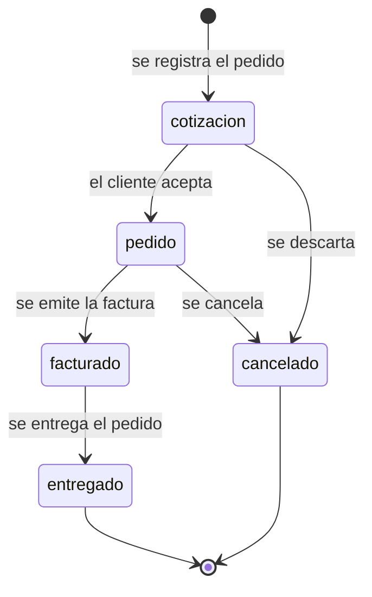

# Plan de Implementación: Módulo de Ventas

**Rama**: `002-modulo-ventas` | **Fecha**: 2026-10-21 | **Especificación**: [spec.md](spec.md) | **Modelo de Datos**: [data-model.md](data-model.md)
**Entrada**: Especificación de la funcionalidad desde `/specs/002-modulo-ventas/spec.md`
**Alcance de este documento**: plan alineado con el modelo de datos de `specs/002-modulo-ventas/data-model.md` (entidades, relación, ciclo de vida, restricciones y persistencia)

## Resumen

Generar el módulo ERP de **Ventas** como una carpeta autónoma (`modulo-ventas/`) a partir del módulo base (`001-erp-base-module`). El módulo base fue restaurado desde el historial de git (commit `501e9c6`, último estado completo antes de su eliminación en `a0062c0`) y colocado en la nueva carpeta junto con sus pruebas. Toda la adaptación al dominio de ventas se realizó mediante el único punto de configuración `userConfig` en `modulo-ventas/src/module-config.js`, sin modificar el código central:

- **Entidad → Cliente**, **Documento → Pedido de Venta** (etiquetas en todas las pantallas).
- **Campos personalizados**: vendedor asignado y zona (cliente); canal de venta y fecha de entrega (pedido).
- **Ciclo de vida**: cotización → pedido → facturado → entregado, con cancelación desde cotización o pedido.
- **Marca**: nombre "Ventas" y color de acento `#0f62fe`.

Sobre esa base de configuración, el modelo de datos especializa el modelo genérico del módulo base sin tocar su núcleo: **CLIENTE** actúa como raíz del agregado comercial (maestro del comprador) y **PEDIDO_VENTA** como entidad dependiente (transacción comercial). Cada pedido pertenece a exactamente un cliente mediante la clave foránea `entity_id` —obligatoria y validada al escribir—, mientras que un cliente admite cero o N pedidos; la eliminación de un cliente arrastra en cascada sus pedidos y el borrado de un pedido nunca afecta al cliente. Ambos registros conviven en el `localStorage` del navegador (`erp_base_module:entities` y `erp_base_module:documents`), sin backend ni base de datos relacional, y quedan sujetos a 18 reglas de integridad (R-01 a R-18) que cubren la obligatoriedad de nombre y código del cliente, el formato del correo y de la fecha objetivo, el folio entero positivo, la coherencia de fechas, los montos no negativos, el descuento no superior al subtotal y la pertenencia de `status`, `zona` y `canal` a los valores declarados.

El perfil de configuración inyecta además el vocabulario del área: cuatro campos propios (`vendedor`, `zona`, `canal`, `fechaEntrega`) que se validan, se persisten y participan en la búsqueda, y un ciclo de vida de cinco estados cuyas transiciones inválidas se rechazan con el mensaje `Transición de estado inválida de "<origen>" a "<destino>"`. El panel expone en vivo dos estadísticas derivadas de las colecciones (total de clientes y total de pedidos). Quedan fuera de alcance las extensiones previstas en el modelo de datos (catálogo de productos, líneas de pedido, cotización y devolución como entidades propias, y normalización del vendedor).

## Contexto Técnico

**Lenguaje/Versión**: JavaScript (ES2022), HTML, CSS  
**Dependencias Principales**: Vite, Vitest + jsdom (sin framework de interfaz)  
**Almacenamiento**: localStorage del navegador — dos colecciones: `erp_base_module:entities` (Clientes) y `erp_base_module:documents` (Pedidos de Venta)  
**Modelo de Datos**: `CLIENTE` (maestro) y `PEDIDO_VENTA` (transacción) en relación 1:N, con FK obligatoria, borrado en cascada y 18 reglas de integridad — ver [data-model.md](data-model.md)  
**Estructura**: la carpeta `modulo-ventas/` es autocontenida (index.html, src/, tests/) y se ejecuta con `vite modulo-ventas` desde la raíz del repositorio  
**Comandos**: `npm run dev`, `npm run build`, `npm test` (apuntan a `modulo-ventas/`)

## Estructura del Proyecto

### Documentación (esta funcionalidad)

```text
specs/002-modulo-ventas/
├── spec.md
├── data-model.md
└── plan.md
```

### Código Fuente (carpeta nueva)

```text
modulo-ventas/
├── index.html
├── src/
│   ├── main.js
│   ├── styles.css
│   ├── storage.js
│   ├── app.js
│   ├── module-config.js      ← único archivo editado para Ventas (userConfig)
│   └── components/
│       ├── shell.js
│       ├── dashboard.js
│       ├── entity-form.js
│       ├── entity-list.js
│       ├── document-form.js
│       ├── document-list.js
│       ├── custom-fields.js
│       └── search-bar.js
└── tests/
    ├── unit/
    └── integration/
```

**Decisión de Estructura**: `storage.js` y los componentes permanecen genéricos; toda la semántica de ventas entra por `userConfig`. El modelo de datos, por tanto, no se implementa como un esquema nuevo sino como la proyección del perfil de configuración sobre las dos colecciones genéricas (entidades y documentos), lo que mantiene la trazabilidad directa entre modelo documentado y comportamiento observable.

## Cambios Realizados

1. **Restauración**: se recuperaron `index.html`, `src/` y `tests/` del commit `501e9c6` mediante un worktree temporal de git.
2. **Configuración de Ventas** en `modulo-ventas/src/module-config.js`:

```js
export const userConfig = {
  moduleName: 'Ventas',
  labels: { entity: 'Cliente', entities: 'Clientes',
            document: 'Pedido de Venta', documents: 'Pedidos de Venta' },
  customFields: [
    { target: 'entity', key: 'vendedor', label: 'Vendedor asignado', type: 'text' },
    { target: 'entity', key: 'zona', label: 'Zona', type: 'select',
      options: ['Norte', 'Sur', 'Este', 'Oeste', 'Centro'] },
    { target: 'document', key: 'canal', label: 'Canal de venta', type: 'select',
      options: ['Tienda', 'Web', 'Teléfono', 'Distribuidor'] },
    { target: 'document', key: 'fechaEntrega', label: 'Fecha de entrega', type: 'date' }
  ],
  statusLifecycle: {
    statuses: ['cotización', 'pedido', 'facturado', 'entregado', 'cancelado'],
    transitions: {
      cotización: ['pedido', 'cancelado'],
      pedido: ['facturado', 'cancelado'],
      facturado: ['entregado'],
      entregado: [],
      cancelado: []
    }
  },
  theme: { accentColor: '#0f62fe' }
};
```

3. **Modelo de datos documentado** en `specs/002-modulo-ventas/data-model.md`: fija las entidades `CLIENTE` y `PEDIDO_VENTA`, la relación 1:N con FK obligatoria y borrado en cascada, el ciclo de vida de estados, las 18 reglas de integridad, la persistencia en `localStorage`, las extensiones previstas y la trazabilidad con la especificación. No introduce cambios de código: describe el comportamiento que el módulo base ya ofrece al recibir el perfil de configuración de Ventas.
4. **Ajustes menores**:
   - `index.html`: título por defecto → "Ventas".
   - `tests/unit/module-config.test.js`: la prueba de `loadModuleConfig` ahora verifica la configuración de Ventas en lugar del default nulo.
   - `package.json` (raíz): scripts `dev`, `build`, `preview` y `test` apuntan a `modulo-ventas/`.

## Modelo de Datos

### Entidades y persistencia

| Entidad | Papel | Clave de negocio | Campos propios | Colección (`localStorage`) |
|---|---|---|---|---|
| `CLIENTE` | Maestro del comprador (raíz del agregado) | `entity_id` (UK) | `vendedor`, `zona` | `erp_base_module:entities` |
| `PEDIDO_VENTA` | Transacción comercial (dependiente) | `entity_id` (FK → `CLIENTE.entity_id`) | `canal`, `fechaEntrega` | `erp_base_module:documents` |

```mermaid
erDiagram
    CLIENTE ||--o{ PEDIDO_VENTA : "genera"
    CLIENTE {
        string id PK
        string entity_id UK
        string name NN
        string code NN
        string vendedor "campo propio"
        string zona "campo propio"
        string createdAt NN
        string updatedAt NN
    }
    PEDIDO_VENTA {
        string id PK
        string entity_id FK
        string series
        number folio NN
        string startDate NN
        string endDate NN
        string status
        string canal "campo propio"
        string fechaEntrega "campo propio"
        string createdAt NN
        string updatedAt NN
    }
```

### Relación CLIENTE 1 : N PEDIDO DE VENTA

| Aspecto | Definición |
|---|---|
| Dirección | `PEDIDO_VENTA.entity_id` → `CLIENTE.entity_id` |
| Cardinalidad cliente → pedido | `1 .. N` (un cliente puede no tener pedidos) |
| Cardinalidad pedido → cliente | `1 .. 1` (obligatoria, un pedido siempre tiene un cliente) |
| Integridad referencial | El `entity_id` debe existir en la colección de clientes al crear y al editar el pedido |
| Borrado en cascada | Al eliminar un cliente se eliminan sus pedidos (`deleteDocumentsForEntity`) |
| Borrado de pedido | Nunca afecta al cliente; solo se retira el pedido |

Consecuencias: no existen pedidos huérfanos; los pedidos de un cliente eliminado desaparecen de la lista, de la gestión y de la búsqueda; la cascada no distingue por estado.

### Ciclo de vida del pedido



| Estado actual | Transiciones permitidas | Estado final |
|---|---|---|
| `cotización` | `pedido`, `cancelado` | No |
| `pedido` | `facturado`, `cancelado` | No |
| `facturado` | `entregado` | No |
| `entregado` | — | Sí |
| `cancelado` | — | Sí |

Al crear un pedido se ofrecen todos los estados configurados; al editarlo, solo el estado actual y sus transiciones válidas. Una transición no permitida se rechaza con `Transición de estado inválida de "<origen>" a "<destino>"`. Si se retira el ciclo de vida de la configuración, `status` vuelve a ser texto libre.

### Restricciones de integridad (R-01 a R-18)

| Ámbito | Reglas | Contenido |
|---|---|---|
| Cliente | R-01 a R-06 | `name` y `code` obligatorios; `email` con formato válido; `targetDate` como fecha `YYYY-MM-DD` válida; `creditLimit` no negativo; `zona` dentro de las opciones declaradas |
| Pedido | R-07 a R-17 | `entity_id` referencia un cliente existente; `folio` entero positivo; `startDate` y `endDate` fechas válidas; `endDate` ≥ `startDate`; `quantity` entero positivo; `subtotal`, `discount`, `taxAmount` y `totalAmount` no negativos; `discount` ≤ `subtotal`; `status` en el ciclo configurado con transición permitida; `canal` en las opciones declaradas; `fechaEntrega` como fecha válida |
| Configuración | R-18 | Las claves de campos propios no colisionan con campos base ni se repiten; si la configuración es inválida se usan los valores predeterminados |

### Extensiones previstas (fuera del alcance actual)

| Entidad propuesta | Propósito | Impacto |
|---|---|---|
| `PRODUCTO` (catálogo / lista de precios) | Consultar precios y existencias antes de cotizar | Medio |
| `DETALLE_PEDIDO` (líneas) | Desglosar el pedido en producto, cantidad y precio unitario | Medio |
| `COTIZACION` | Pre-venta con vigencia y aceptación del cliente | Bajo (cubierto parcialmente por el estado `cotización`) |
| `DEVOLUCION` | Registrar la devolución de un pedido facturado | Bajo (pedido en `cancelado` + campo `pedidoOrigen`) |
| `VENDEDOR` normalizado | Maestro de comerciales con zona y cartera | Medio |

## Verificación

- `npm test`: **111/111 pruebas pasan** (12 archivos: unit + integration).
- `npm run build`: compila sin errores (salida en `modulo-ventas/dist/`).
- Trazabilidad del modelo: cada elemento de `data-model.md` se corresponde con un requisito o criterio de `spec.md` (FR-002 a FR-006, SC-001 a SC-004) y con pruebas de la suite.

## Seguimiento de Complejidad

Este plan no introdujo violaciones de la constitución: la adaptación se hizo únicamente a través del mecanismo de configuración previsto por el módulo base, con cero cambios en el código central. El modelo de datos documenta el comportamiento emergent de esa configuración en lugar de introducir un esquema paralelo, evitando duplicar la lógica de validación y persistencia.
